# PLAN

A demo of a fractional real estate investing platform. Simulated money only.

## 1. Architecture

```
Browser ── Next.js App Router (server components by default)
             │
             ├─ src/app/**            pages, layouts, route handlers (cron, auth)
             ├─ src/app/**/actions.ts server actions: Zod-validate → authorise → call a service
             │
             ├─ src/lib/domain/**     PURE functions. No database, no clock, no I/O.
             │     money · dividends · matching · voting · holding · trading-rules · exit
             │
             ├─ src/lib/services/**   Database transactions that apply domain results.
             │     wallet · purchase · funding · dividends · trading · governance ·
             │     exit · snapshots · notifications · audit · jobs
             │
             ├─ src/lib/providers/**  Adapters for every outside service (interface + mock)
             │
             └─ Prisma ── PostgreSQL (Neon in production, local Postgres in dev/test)
```

Rules the code follows:

- **Money is `bigint` cents. Shares are `bigint` micro-shares** (1 share = 1,000,000 units). All
  rounding lives in `src/lib/domain/money.ts`. No floats touch a balance.
- **Pure core, thin shell.** Every financial rule (allocation, matching, caps, quorum) is a pure
  function with unit tests. Services only lock rows, call the pure function, and write the result.
- **Ledger.** Every money movement writes balanced `LedgerEntry` rows that share a `referenceId`
  and sum to zero across accounts (user wallets, property escrow, property operating, liquidity
  reserve, external). A user's wallet must equal the sum of their `USER_WALLET` entries;
  `reconcile()` checks this and the admin dashboard shows the result. The ledger and audit log
  are append-only, enforced by a database trigger.
- **Concurrency.** Purchases, order placement/matching, dividends, buybacks and exits run in one
  transaction each and take `SELECT … FOR UPDATE` locks in a fixed order (property → wallets by
  user id). `CHECK` constraints stop any balance going negative even if the code is wrong.
- **Idempotency.** Purchase, order, deposit, and payout actions carry a key stored in
  `IdempotencyKey`; a repeat returns the first result.
- **Never trust the client** for prices, balances, or share counts — the server recomputes them.

### Product decisions (documented, changeable)

| Decision | Choice | Why |
|---|---|---|
| Shares bought back by the reserve | **Retired** (not held by the platform) | Remaining holders funded the reserve from their income; retiring the shares returns the benefit to them as a larger slice of each later dividend. No platform-owned position to explain. |
| Primary purchase rounding | Units round **down**, cost rounds **up** to the cent, never above the amount entered | The buyer never pays more than they typed; no fractional cents are created. |
| Trade notional rounding | Half-up, one figure used for both sides | Buyer pays exactly what the seller receives. |
| Dividend rounding | Largest-remainder; leftover cents carry to next month | Fair and deterministic; nothing is lost. |
| Trade price | The resting (earlier) order's price | Standard price-time priority. |
| Self-trading | A user's orders never match each other | Prevents wash trades. |
| Voting record date | Holdings rebuilt from the ledger as of the record date | Buying shares after the record date cannot buy votes. |
| Planned exit vote | FOR = sell now. If it fails or lacks quorum, the exit year extends by the stated 1–2 years | Holders always have a default outcome. |
| Failed funding | Every purchase refunded in full, property marked `CANCELLED` | |
| Fees | Zero in the demo, but the fee line is always shown | |

## 2. Data model

```mermaid
erDiagram
  User ||--o| Wallet : has
  User ||--o{ LedgerEntry : "cash + share movements"
  User ||--o{ Holding : owns
  User ||--o{ HoldingLot : "per-purchase lots"
  User ||--o{ PrimaryPurchase : makes
  User ||--o{ Order : places
  User ||--o{ DividendPayment : receives
  User ||--o{ Vote : casts
  User ||--o{ Notification : gets
  User ||--o{ PortfolioSnapshot : "daily value"
  User ||--o{ ExitPayout : "final return"
  Property ||--o{ PropertyPhoto : shows
  Property ||--o{ Appraisal : "valued by"
  Property ||--o{ Holding : "held as"
  Property ||--o{ HoldingLot : "held as"
  Property ||--o{ PrimaryPurchase : "sold via"
  Property ||--o{ Order : "book"
  Property ||--o{ Trade : "prints"
  Property ||--o{ TradingWindow : "scheduled"
  Property ||--o{ MonthlyFinancials : reports
  Property ||--o{ DividendDistribution : distributes
  Property ||--o| LiquidityReserve : "buyback fund"
  Property ||--o{ Proposal : "governed by"
  Property ||--o{ Document : publishes
  Property ||--o{ LedgerEntry : "escrow / operating / reserve"
  Property ||--o{ ExitPayout : "pays on sale"
  TradingWindow ||--o{ Order : contains
  Order ||--o{ Trade : "buy / sell side"
  DividendDistribution ||--o{ DividendPayment : "pays"
  Proposal ||--o{ Vote : collects
  PlatformSettings
  AuditLog
  IdempotencyKey
  RateLimit
```



## 3. Page map

| Area | Routes |
|---|---|
| Marketing | `/` · `/how-it-works` · `/properties` · `/properties/[slug]` |
| Legal (DRAFT banner) | `/legal/terms` · `/legal/privacy` · `/legal/risks` · `/legal/offering-documents` |
| Auth | `/signup` · `/login` · `/forgot-password` · `/reset-password/[token]` |
| Onboarding | `/onboarding` (profile → identity check → risk disclosure → fund wallet → tour) |
| Investing | `/properties/[slug]/invest` · `/properties/[slug]/trade` |
| Account | `/portfolio` · `/portfolio/activity` · `/portfolio/statements` · `/portfolio/statements/[month]` · `/wallet` · `/orders` · `/governance` · `/proposals/[id]` · `/notifications` |
| Admin | `/admin` · `/admin/properties` (+ `/new`, `/[id]`) · `/admin/financials` · `/admin/dividends/[id]` · `/admin/trading` · `/admin/reserves` · `/admin/proposals` (+ `/new`, `/[id]`) · `/admin/users` (+ `/[id]`) · `/admin/settings` · `/admin/audit` |
| Design system | `/design` |
| Cron (secret-protected) | `/api/cron/snapshots` · `/draft-dividends` · `/trading-windows` · `/funding-deadlines` · `/exit-votes` · `/proposals` |

## 4. Adapter interfaces (`src/lib/providers`)

| Interface | Mock in the demo | Real provider later |
|---|---|---|
| `PaymentsProvider` — `linkBankAccount`, `initiateDeposit`, `initiateWithdrawal` | Instantly "settles" simulated transfers | ACH processor (e.g. Plaid + Dwolla / Stripe Treasury) |
| `KycProvider` — `startVerification`, `getVerification`, `checkAccreditation` | Approves after a delay; rejects emails containing `+reject@` | Persona / Alloy / Jumio + AML screening |
| `CustodyProvider` — `recordIssuance`, `recordTransfer`, `recordRetirement`, `getPositionOfRecord` | Reads/writes the app's own holdings tables | Transfer agent / qualified custodian |
| `TradingVenueProvider` — `submitOrder`, `cancelOrder`, `getOrderBook` | The internal price-time matching engine | An SEC-registered ATS run by a broker-dealer |
| `EmailProvider` — `send` | Logs to the console | Postmark / SES / Resend |
| `DocumentStorageProvider` — `put`, `getUrl`, `delete` | Stores metadata, returns a placeholder URL | S3 / Vercel Blob with signed URLs |

`src/lib/providers/index.ts` is the only place that chooses an implementation.

## 5. Milestones

- [ ] 1. Project setup, design tokens, design system components, `/design`
- [ ] 2. Data model, migrations, seed, auth, roles, onboarding, mock KYC
- [ ] 3. Marketplace, property detail, buying in the initial offering
- [ ] 4. Wallet, ledger, portfolio dashboard, statements
- [ ] 5. Monthly financials and the dividend workflow
- [ ] 6. Order book, matching, trading windows, holding periods, circuit breaker, reserve buyback
- [ ] 7. Governance: proposals, capped voting, quorum, exit votes, sale proceeds
- [ ] 8. Admin panel, settings, audit log, notifications
- [ ] 9. Marketing site, legal drafts, copy polish
- [ ] 10. Security, accessibility, performance, full tests, deployment setup
