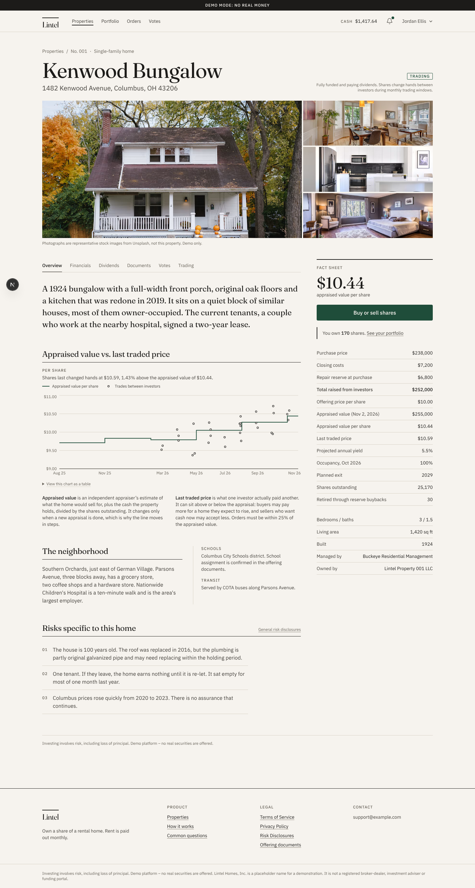
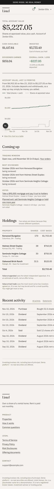

# Lintel — fractional rental-home investing (demo)

A production-quality **demo** of a platform where people buy shares of individual rental homes
from $26, receive their share of the rent monthly, trade shares with each other during monthly
trading windows, and vote on major decisions about the homes they own.

> **Simulated money only.** Nothing here moves real money, talks to a brokerage, or checks real
> identities. Every page carries a "Demo mode: no real money" banner. Legal pages are unreviewed
> drafts.

The brand name lives in one place: `src/config/brand.ts`.

| Home (desktop) | Property fact sheet | Portfolio (phone) |
|---|---|---|
|  |  |  |

More in [`docs/screenshots/`](docs/screenshots).

---

## Demo accounts

After `pnpm db:seed`:

| Role | Email | Password |
|---|---|---|
| Admin | `admin@demo.test` | `demo-admin-2026` |
| Investor (holds 4 properties, has open orders and votes) | `investor@demo.test` | `demo-investor-2026` |
| 20 more investors | e.g. `marcus.bell@demo.test`, `amara.okafor@demo.test` (see `prisma/seed-data.ts`) | `demo-investor-2026` |

Sign up with an email containing `+reject@` (e.g. `sam+reject@example.com`) to see the identity
check fail.

The seed runs the real services with backdated clocks to build ~20 months of history: three
funded homes trading, two offerings filling, one coming soon, one in its planned-exit vote; 12
months of income statements (a vacancy month, big repairs, an insurance jump); appraisals; ~110
trades including partial fills and reserve buybacks; dividends; past and open votes. A trading
window is open right after seeding, and last month's dividends are left as drafts for the admin
to approve and pay. The seed ends by reconciling the books and fails if they do not balance.

---

## Run it locally

Requirements: Node 20+ (22 recommended), pnpm 10, PostgreSQL 14+.

```bash
pnpm install
cp .env.example .env            # then edit secrets (see below)
createdb hearth && createdb hearth_test   # or use the SQL in "Databases" below
pnpm db:migrate                 # prisma migrate deploy
pnpm db:seed                    # wipes and seeds demo data
pnpm dev                        # http://localhost:3000
```

Databases (as the postgres superuser):

```sql
CREATE USER app WITH PASSWORD 'app' CREATEDB;
CREATE DATABASE hearth OWNER app;       -- development
CREATE DATABASE hearth_test OWNER app;  -- integration tests (truncated by tests)
```

Generate secrets with `openssl rand -base64 32` for `AUTH_SECRET` and `CRON_SECRET` (the cron
routes refuse to run with a secret shorter than 16 characters).

### Tests

| Command | What it runs |
|---|---|
| `pnpm test` | Vitest: unit tests for all money, rounding, dividend, matching, holding-period, circuit-breaker, buyback, voting and exit math, plus integration tests against `hearth_test` for purchases, dividends, trading windows, proposals and funding refunds. Every integration test ends by reconciling the ledger. |
| `pnpm test:e2e` | Playwright: sign up → KYC → disclosure → fund → buy $26 → portfolio; admin pays a dividend → investor sees it; one investor sells, another buys, the trade settles; holders vote and the result is computed correctly. Uses its own database `hearth_e2e` and server on port 3300. Add `--trace off` unless you need traces. |
| `pnpm typecheck` | `tsc --noEmit` in strict mode |

Run the scheduled jobs by hand:

```bash
curl -H "Authorization: Bearer $CRON_SECRET" http://localhost:3000/api/cron/trading-windows
# jobs: snapshots · draft-dividends · trading-windows · funding-deadlines · exit-votes · proposals
```

---

## Deploy (Vercel + Neon)

1. **Create a Neon project** (neon.tech). From *Connection details*, copy two URLs:
   the **pooled** URL (host contains `-pooler`) and the **direct** URL. Append
   `?sslmode=require` if not present.
2. **Import the repo into Vercel** (vercel.com → Add New → Project). Framework: Next.js.
   Build command: `pnpm build` (runs `prisma generate`). Install command: `pnpm install`.
3. **Set environment variables** in Vercel (Production and Preview):

   | Variable | Value |
   |---|---|
   | `DATABASE_URL` | Neon pooled URL |
   | `DIRECT_URL` | Neon direct URL (used by migrations) |
   | `AUTH_SECRET` | `openssl rand -base64 32` |
   | `APP_URL` | `https://<your-project>.vercel.app` |
   | `AUTH_TRUST_HOST` | `true` |
   | `CRON_SECRET` | `openssl rand -base64 32` |
   | `KYC_MOCK_DELAY_MS` | `2500` |

   `VERCEL=1` is set by the platform; it tells the rate limiter to trust Vercel's IP headers.
   Elsewhere, set `TRUST_PROXY=1` only behind a proxy that overwrites `X-Forwarded-For`.
4. **Run migrations and the seed** once, from your machine, against Neon:
   ```bash
   DATABASE_URL="<direct url>" DIRECT_URL="<direct url>" pnpm db:migrate
   DATABASE_URL="<direct url>" DIRECT_URL="<direct url>" pnpm db:seed
   ```
5. **Deploy.** `vercel.json` registers the cron jobs; Vercel sends `CRON_SECRET` automatically.
   The hourly jobs (trading windows, proposals, funding deadlines) need a Vercel plan that
   allows hourly crons; on Hobby, change them to daily schedules.
6. **Verify:** open the site, log in as the admin, and check that *Admin → Overview* says the books
   reconcile; call one cron route with the secret and check *Admin → Audit log* shows `cron.*`.

---

## Architecture

Details, the data-model diagram, the page map and decisions are in **[PLAN.md](PLAN.md)**.
Product truth is in **[PRODUCT.md](PRODUCT.md)**; the design system is in **[DESIGN.md](DESIGN.md)**
and on the `/design` page.

```
src/lib/domain/     pure functions: money & rounding, dividends, matching, holding periods,
                    trading rules, voting, exit proceeds — no I/O, fully unit-tested
src/lib/services/   database transactions that apply them, with row locks, idempotency keys,
                    balanced ledger entries and audit entries
src/lib/providers/  adapters for every outside service (interfaces + mocks)
src/app/            pages and server actions (Zod-validated, role-checked on the server)
src/app/api/cron/   scheduled jobs
prisma/             schema, migrations (incl. append-only + non-negative constraints), seed
```

Key rules:
- Money is integer **cents** (`bigint`); shares are integer **micro-shares** (1 share = 1,000,000).
  All rounding is in `src/lib/domain/money.ts`.
- Every money movement writes **balanced ledger entries** (they sum to zero). Wallets, holdings,
  reserves and rounding carry are reconciled against the ledger (`reconcile()`, shown on the
  admin overview). The ledger and audit log are append-only, enforced by database triggers.
- Purchases, matching, dividends, buybacks and sales run in single transactions with row locks
  in a fixed order (trading window → property → wallets by user id). `CHECK` constraints stop any
  balance going negative.
- Dividends are never paid automatically: the monthly job creates drafts; an admin approves, then pays.

### Where real providers plug in

All in `src/lib/providers/`. Swap the implementation in `index.ts`; nothing else changes.

| Interface | Demo mock | Real provider (examples) | Notes |
|---|---|---|---|
| `PaymentsProvider` | settles instantly | ACH via Plaid + Dwolla / Stripe Treasury / Modern Treasury | Real transfers are asynchronous: record a PENDING transfer, credit the wallet from the webhook (see comments in `services/wallet.ts`). |
| `KycProvider` | approves after a delay; `+reject@` fails | Persona, Alloy, Socure, Jumio (+ OFAC/AML screening) | Polled from onboarding today; switch to webhooks. |
| `CustodyProvider` | the app's own tables | A registered transfer agent / qualified custodian | Called after issuance, transfer and retirement. |
| `TradingVenueProvider` | internal price-time matching engine (`services/trading.ts`) | An SEC-registered ATS operated by a broker-dealer | Server actions call `tradingVenue()`. |
| `EmailProvider` | logs to the console | Postmark, SES, Resend | Emails are sent only after the transaction commits. |
| `DocumentStorageProvider` | stores nothing, placeholder URL | S3 / Vercel Blob with signed URLs | Admin uploads go through it. |

---

## Photo credits

Property photographs are royalty-free images from **Unsplash**, used under the
[Unsplash License](https://unsplash.com/license) and hot-linked from `images.unsplash.com`. They
are representative stock photos, **not the actual properties**, and every listing says so. No
AI-generated images are used.

The build environment could not reach Unsplash's website or API to confirm the photographers'
names, so credits are listed by photo ID. **Before any public use, open each link, note the
photographer, and fill in the `credit` / `creditUrl` fields in `prisma/seed-data.ts`** (or in
*Admin → Properties → Photos*), which then appear on the listing.

| Used for | Photo |
|---|---|
| Kenwood Bungalow | [1572120360610-d971b9d7767c](https://images.unsplash.com/photo-1572120360610-d971b9d7767c) · [1560185007-cde436f6a4d0](https://images.unsplash.com/photo-1560185007-cde436f6a4d0) · [1484154218962-a197022b5858](https://images.unsplash.com/photo-1484154218962-a197022b5858) · [1560185893-a55cbc8c57e8](https://images.unsplash.com/photo-1560185893-a55cbc8c57e8) |
| Holmes Street Duplex | [1605276374104-dee2a0ed3cd6](https://images.unsplash.com/photo-1605276374104-dee2a0ed3cd6) · [1493809842364-78817add7ffb](https://images.unsplash.com/photo-1493809842364-78817add7ffb) · [1556911220-bff31c812dba](https://images.unsplash.com/photo-1556911220-bff31c812dba) · [1505693416388-ac5ce068fe85](https://images.unsplash.com/photo-1505693416388-ac5ce068fe85) |
| Seminole Heights Cottage | [1583608205776-bfd35f0d9f83](https://images.unsplash.com/photo-1583608205776-bfd35f0d9f83) · [1560448204-e02f11c3d0e2](https://images.unsplash.com/photo-1560448204-e02f11c3d0e2) · [1560448075-bb485b067938](https://images.unsplash.com/photo-1560448075-bb485b067938) · [1502672260266-1c1ef2d93688](https://images.unsplash.com/photo-1502672260266-1c1ef2d93688) |
| Oakwood Brick Ranch | [1598228723793-52759bba239c](https://images.unsplash.com/photo-1598228723793-52759bba239c) · [1554995207-c18c203602cb](https://images.unsplash.com/photo-1554995207-c18c203602cb) · [1565182999561-18d7dc61c393](https://images.unsplash.com/photo-1565182999561-18d7dc61c393) |
| Meridian-Kessler Fourplex | [1570129477492-45c003edd2be](https://images.unsplash.com/photo-1570129477492-45c003edd2be) · [1600210492486-724fe5c67fb0](https://images.unsplash.com/photo-1600210492486-724fe5c67fb0) · [1522708323590-d24dbb6b0267](https://images.unsplash.com/photo-1522708323590-d24dbb6b0267) |
| Crestwood Craftsman | [1599427303058-f04cbcf4756f](https://images.unsplash.com/photo-1599427303058-f04cbcf4756f) · [1586023492125-27b2c045efd7](https://images.unsplash.com/photo-1586023492125-27b2c045efd7) |

Fonts: Fraunces and IBM Plex Sans (SIL Open Font License), self-hosted through `next/font`.
Icons: Lucide (ISC).

---

## Further reading

- [PLAN.md](PLAN.md): architecture, data model, page map, milestones (what was built)
- [ATTORNEY_QUESTIONS.md](ATTORNEY_QUESTIONS.md): every legal and regulatory assumption, and open questions
- [NEXT_STEPS.md](NEXT_STEPS.md): what it would take to go from demo to launch
